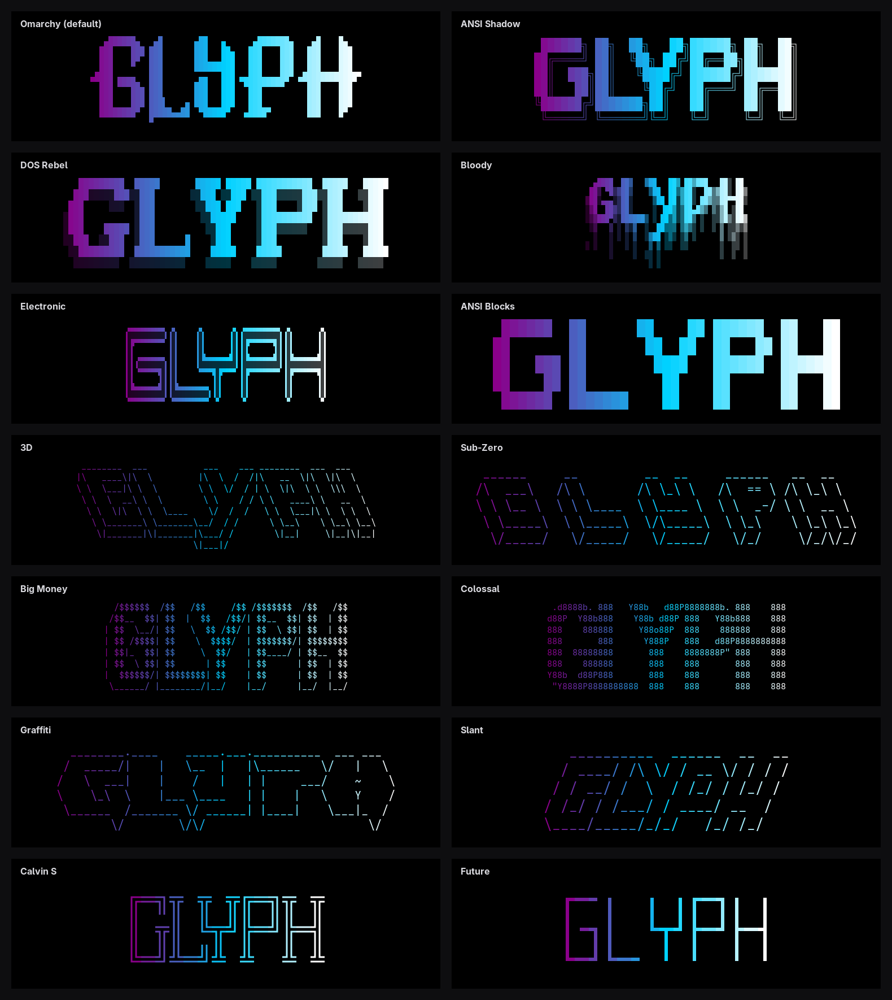

# Glyph Screensaver

**I loved my time on Omarchy, but I missed GNOME.** So I went back to Fedora 45 with GNOME 51, and soon found myself missing Omarchy's gorgeous screensaver. With Claude by my side, I decided to bring it to GNOME. I hope you enjoy it!

An animated ASCII-art screensaver for GNOME. Your text in big figlet letters on a pure black screen, brought to life by [terminaltexteffects](https://github.com/ChrisBuilds/terminaltexteffects). Inspired by the [Omarchy](https://omarchy.org) screensaver.


## Features

- **Native GNOME Shell overlay.** Drawn by the shell itself (no terminal window), pure black, cursor hidden, on top of everything.
- **37 animations** from terminaltexteffects. A random one plays each cycle, with Omarchy's exact settings. Turn effects on or off and preview each one from the settings.
- **14 font styles**, with Omarchy's Delta Corps Priest as the default. A live preview shows your text as you type.
- **Behaves well.** Starts after your chosen idle time and stays away during video, calls and fullscreen apps. Any key or mouse movement dismisses it.



## Install

One command:

```bash
curl -fsSL https://raw.githubusercontent.com/Chanevan317/Glyph-Screensaver/main/install.sh | bash
```

If it asks you to, log out and back in. That's it: Glyph Screensaver then shows up in Extension Manager like any other extension.

You need GNOME Shell 45 or newer and Python 3.8+. On Debian/Ubuntu, run `sudo apt install python3-venv` first.

Installed it from Extension Manager or extensions.gnome.org? Run the same command once to set up the animation engine; the extension's settings remind you if it's missing.

<details>
<summary>What the command does</summary>

It puts the animation engine (`terminaltexteffects` + `pyfiglet`) in a private virtualenv at `~/.local/share/glyph-screensaver/venv`, installs the latest release of the extension (unless it's already installed), and enables it. Nothing is installed system-wide and no `sudo` is used. Running `./install.sh` from a clone installs that checkout instead.

</details>

## Settings

Open **Extensions → Glyph Screensaver → Settings** to change the text (leave it empty to use your user name), the font style and size, and the idle delay, to pick effects, or to press **Preview**.

## How it works

`helper/tte_stream.py` drives terminaltexteffects' engine with the same options Omarchy's screensaver uses and streams each frame's characters to the extension. `renderer.js` paints them on the overlay the way a terminal would, drawing block and box characters itself so the letters are seamless.

## Compatibility

Declared for GNOME 45–51. Developed and tested on GNOME 51 (Fedora 45). Reports from other versions are welcome.

## Credits

- [terminaltexteffects](https://github.com/ChrisBuilds/terminaltexteffects) by ChrisBuilds: the animation engine
- [pyfiglet](https://github.com/pwaller/pyfiglet) and the FIGlet font authors: the letter styles
- [Omarchy](https://github.com/basecamp/omarchy): the inspiration and its screensaver settings

Not affiliated with Omarchy or the GNOME Project.

## License

[MIT](LICENSE)
